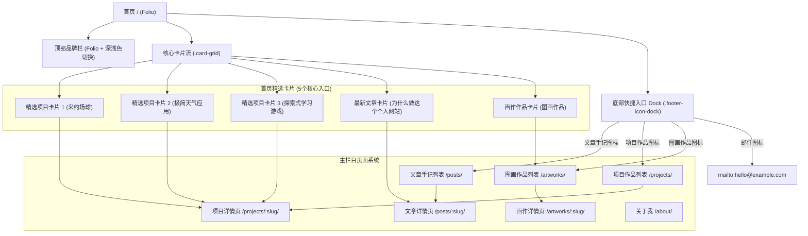
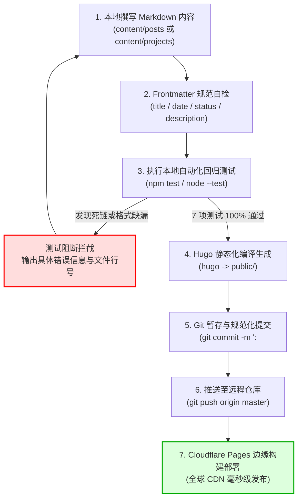
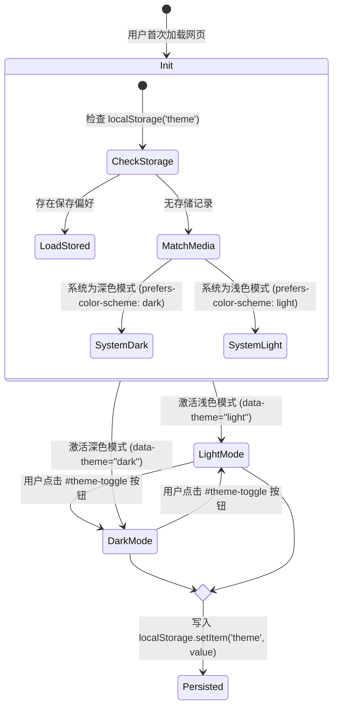

# Folio 个人数字空间 · 业务逻辑链条与防呆拓扑 (业务逻辑链条.md)

> 本文档是 `Folio` 项目业务与内容生命周期的**单一真源 (Single Source of Truth)**。详细定义了站点信息架构、内容编译流水线、状态机流转与防呆拦截规则。

---

## 一、 站点信息架构与导航拓扑 (Site IA)

---

## 二、 内容发布与自动化构建流程 (DAG 拓扑)

整个站点遵循严格的 DAG 单向无环流水线：

---

## 三、 深色 / 浅色主题状态机 (Theme State Machine)

站点支持原生系统级偏好自适应，并支持用户主动覆盖并持久化存储：

---

## 四、 防呆与边界拦截矩阵 (Guardrail Matrix)

为避免因输入失误、链接破损或字段不全导致线上破损，系统设立如下拦截矩阵：

| 校验维度 | 检查项 | 允许合法值 / 规范标准 | 违规场景后果 | 拦截层级 | 拦截/修复提示 |
| :--- | :--- | :--- | :--- | :--- | :--- |
| **项目元数据** | `status` 枚举限制 | `原型阶段`、`原型设计`、`进行中`、`开发中`、`已上线`、`概念构思`、`机制重塑中`、`验证中`、`迭代中`、`作品集`、`个人项目` | 状态标签渲染失效或颜色混乱 | `npm test` 用例 3 | `项目 status [XXX] 不在允许枚举值中: content/projects/...` |
| **文章元数据** | `date` 格式校验 | 符合 ISO8601 标准，如 `YYYY-MM-DD` 或 `YYYY-MM-DDTHH:mm:ss+08:00` | 文章时序排序错乱、RSS 无法解析 | `npm test` 用例 3 | `必须包含合法的 ISO 日期: content/posts/...` |
| **站内链接** | 内部 URL 死链排查 | 站内 `href` 引用的相对路径必须有对应的实体 `index.html` 存在 | 访客点击后出现 404 错误 | `npm test` 用例 5 | `检测到死链: [fileA] 中引用的 [linkB] 对应物理文件不存在` |
| **多语言与转义** | 中文标签转义匹配 | Hugo 生成的 URL 中文转义需使用 `decodeURIComponent` 对应实际系统路径 | 中文标签页面找不到实体文件报虚假死链 | 构建脚本 & 自动化测试 | 测试套件已内置规范化转义解码 |
| **样式与依赖** | 外部 CDN 脚本拦截 | 严格零外部脚本；无外链 `<script src="https://...">` | 引入第三方追踪或导致脱机无法运行 | `npm test` 用例 7 | `严禁引入外部未授权 CDN 脚本` |
| **性能基线** | 样式表包体积预算 | `public/css/style.css` 必须小于 50KB | 首页首屏渲染延迟，影响极速体验 | `npm test` 用例 7 | `CSS 文件体积需小于 50KB，当前为 X KB` |
| **构建速度** | Hugo 全量编译时限 | 冷构建全量生成时长不超过 2000ms（当前基线 ~150ms） | 编译管道严重衰减或模板死循环 | `npm test` 用例 1 | `构建耗时需小于 2000ms` |
